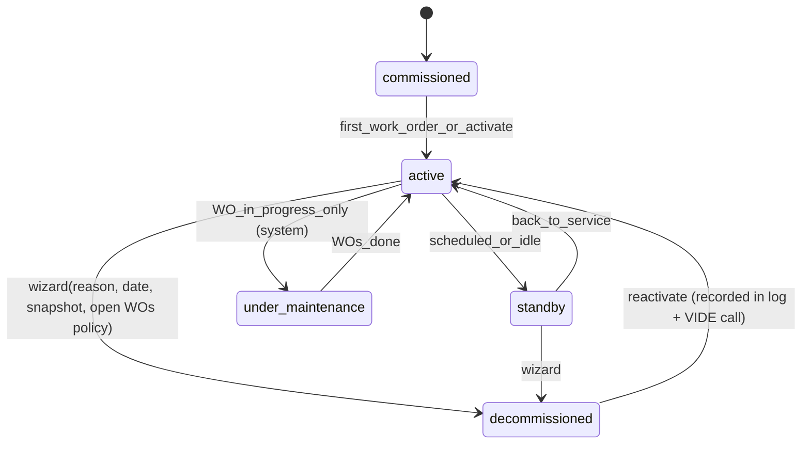
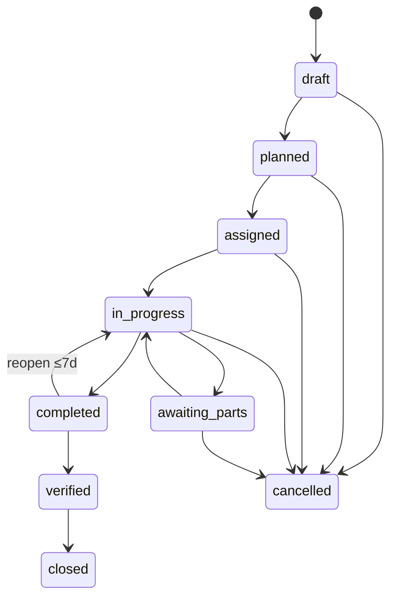

# Cogitex Maintenance Planner — Data Model

> **Status: PLANNING — awaiting approval.** Full schema with relations and state machines.
> Conventions in §1 are binding for every table. Naming: `snake_case`, plural table names.
> Money = integer kobo + currency column. Timestamps = `timestamptz` UTC. "org table" = carries
> `organization_id NOT NULL REFERENCES organizations(id)` and is never queryable without it.

## 1. Global conventions

- **IDs:** `uuid` PKs (`gen_random_uuid()`). Human-identifiers separate (e.g. machine `tag`,
  WO `number`).
- **Audit columns on all mutable tables:** `created_at timestamptz NOT NULL DEFAULT now()`,
  `updated_at timestamptz NOT NULL ...` (app-maintained), `created_by uuid REFERENCES users`,
  (where meaningful) `updated_by uuid`.
- **Soft delete:** `deleted_at timestamptz NULL` on: `machines, sites, areas, maintenance_templates,
  inventory_items, suppliers, documents`. Repository queries exclude `deleted_at IS NOT NULL`
  unless explicitly asked (archive views).
- **Tenancy:** see ARCHITECTURE §4 — one Ctx per operation; every tenant query filtered by org.
- **Append-only tables (UPDATE/DELETE prohibited at DB level via rules/triggers + CI test):
  `stock_movements, audit_logs, machine lifecycle history via machine_lifecycle_log,
  repair_request_events, agent_tool_logs, webhook_in_events (except status columns), fault_events
  (only status/clear columns may change).**
- **Machine references in snapshots:** historical tables copy a compact `snapshot jsonb`
  (machine tag/name/site/category/criticality at that time) so history survives renames/moves.
- **Retention:** health samples 90d, energy aggregates 400d, fault evidence bounded (32 KB/row),
  raw webhook payloads 180d, agent transcripts 180d (org-configurable later).

## 2. Entity overview

```
organizations
├─ sites ── areas
├─ memberships (user, org, role) ──► users ── user_auth_identities
├─ machines
│   ├─ machine_devices               (mapping to VIDE/Cortex devices)
│   ├─ machine_components ─ component_parts ──► inventory_items
│   ├─ maintenance_templates ─ template_steps
│   ├─ schedules ──► schedule_runs ──► work_orders
│   ├─ fault_events (ingested from VIDE/Cortex) ──► work_orders
│   ├─ vide_cache                    (health/energy/runtime summaries per machine)
│   ├─ work_orders
│   │   ├─ work_order_steps          (checklist instantiated from template)
│   │   ├─ work_order_labor
│   │   └─ work_order_parts ──► stock_movements
│   ├─ repair_requests ─ repair_request_events ──► technician_profiles
│   └─ documents                     (manuals, drawings, photos…)
├─ inventory_items ── stock_movements (append-only ledger) ── stock_reservations ── suppliers
└─ ops: reports, audit_logs, notifications, webhook_in_events, jobs,
        agent_threads ─ agent_messages ─ agent_tool_logs, org_counters
```

## 3. Tables

### 3.1 Tenant & org

**organizations**
| column | type | notes |
|---|---|---|
| id | uuid PK | |
| name | text NOT NULL | |
| slug | text UNIQUE NOT NULL | |
| currency | text NOT NULL DEFAULT `'NGN'` | ISO-4217 |
| timezone | text NOT NULL DEFAULT `'Africa/Lagos'` | display tz |
| settings | jsonb `{}` | feature flags, retention overrides weekly/biweekly hours, alert prefs |

**sites** (org)
`id, organization_id FK, name, code, address, notes, deleted_at, audit cols` — UNIQUE(org, lower(code)).

**areas** (org — production areas / halls / lines)
`id, organization_id FK, site_id FK NOT NULL, name, code, kind TEXT CHECK (kind IN ('area','line')), deleted_at, audit cols` — UNIQUE(org, site, lower(code)).

**org_counters** (org)
`id, organization_id, key text (e.g. 'work_order'), last_value bigint` — UNIQUE(org, key).
Used with `FOR UPDATE` row locks to allocate `WO-{YYYY}-{seq:000000…}` humans numbers safely (per-org).

### 3.2 Identity & roles

**users** (global — one row per physical person, may span orgs/users)
`id uuid PK, email citext UNIQUE, name, phone, avatar_document_id FK→documents NULL,
locale text DEFAULT 'en', onboarded_at, deactivated_at, audit cols`.
Auth credentials live in Auth.js tables via `user_auth_identities`.

**user_auth_identities**
`id, user_id FK, provider text ('password'|'magic_link'|'vide_sso'), subject text,
password_hash text NULL (scrypt envelope: `scrypt$<salt b64>$<key b64>`; NULL for
SSO-provided identities), unique(provider, subject)`.
M0 implementation: session cookie = jose HS256 JWT (30d, httpOnly), verified per request;
org/roles always reloaded from the DB (stale-proof). AUTH_SECRET signs tokens.

**memberships** (org)
`id, organization_id FK, user_id FK, role TEXT CHECK (role IN ('owner','admin','maintenance_manager','technician','viewer','external_technician')), site_scope uuid[] NULL (NULL = all sites),
is_active bool, invited_by, audit cols` — UNIQUE(org, user).

**external_technician_actors** → binds an external technician's marketplace identity to membership:
`membership_id FK, marketplace_technician_id text, verified_at` — used by the auth service to scope
external users to their assigned jobs.

### 3.3 Machines (business records) & structure

**machines** (org) — the centerpiece table
| column | type | notes |
|---|---|---|
| id | uuid PK | |
| organization_id | uuid FK | |
| site_id | uuid FK→sites NULL | required before `active` |
| area_id | uuid FK→areas NULL | |
| name | text NOT NULL | |
| tag | text NOT NULL | e.g. `PUMP-3` — UNIQUE(org, upper(tag)) |
| category | text NOT NULL | suggested set: pump, motor, generator, compressor, conveyor, hvac, chiller, boiler, cnc, fan, mixer, other |
| make, model, serial_number | text | |
| rated_specs | jsonb NOT NULL DEFAULT '{}' | `{rated_load_kw, voltage_v, frequency_hz, rpm, capacity, …}` — mirrored fields Cortex analyze wants |
| install_date | date NULL | |
| warranty_until | date NULL | who: vendor; detail in documents |
| criticality | char CHECK IN ('A','B','C') DEFAULT 'B' | A highest |
| location_note | text | "in row 2 near boiler" |
| lifecycle_status | enum — see §4.1 | DEFAULT 'commissioned' |
| decommission | jsonb NULL | `{reason, effective_at, disposition_of_parts, open_wo_policy}` |
| runtime_hours | numeric(12,1) DEFAULT 0 | maintained from VIDE runtime feed; manual adjust audited |
| runtime_base_offset | numeric(12,1) DEFAULT 0 | meter pre-history |
| vide_health_cached | jsonb NULL | last known: `{status, score, as_of, stale}` — write-only by cache service (also in `vide_cache`, this denorm keeps list queries cheap) |
| profile_snapshot | jsonb NULL | frozen copy used in repair briefs |
| pair_notes | text | linking notes to devices |
| deleted_at | timestamptz NULL | soft delete |
| audit cols | | created_by/updated_by |
INDEXES: (org, lifecycle_status), (org, site_id), (org, status), (org, category), trigram on name.
Hard-delete policy enforced in service: zero records only, admin only.

**machine_lifecycle_log** (org, append-only)
`id, machine_id FK, from_status, to_status, reason text, effective_at, actor_user_id, vide_call_status ('acknowledged'|'failed'|'skipped'), created_at` — every lifecycle change, with restore after VIDE advisory call.

**machine_devices** (org) — mapping to VIDE devices (mapping lives HERE per brief §3)
`id, organization_id, machine_id FK, vide_machine_name text, vide_device_id text NULL, kind ('machine'|'device'), status_cache jsonb NULL, linked_at, unlinked_at` — UNIQUE(org, vide_machine_name) while linked; unlinks keep history (`unlinked_at`).

**machine_components** (org) — BOM nodes
`id, organization_id, machine_id FK, name, tag NULL, kind text (motor/bearing/seal/…), location_note, parent_component_id FK self NULL, created_by`.
UNIQUE(machine_id, lower(name)).

**component_parts** — compatible inventory:
`component_id FK, item_id FK→inventory_items, qty_default numeric, note` — UNIQUE(component_id, item_id).

### 3.4 Maintenance templates & schedules

**maintenance_templates** (org; template steps)
`id, organization_id, name, description text, category_scope text[] (machine categories this fits),
default_labor_minutes int, required_skill TEXT CHECK IN ('none','basic','intermediate','specialist'),
interval_days int NULL (calendar hint), is_active bool, ordering preserved via template_steps`.
UNIQUE(org, lower(name)). Soft delete via `is_active=false` + `deleted_at`.

**template_steps**
`id, template_id FK, step_no int, instruction text NOT NULL, require_photo bool, require_value bool,
value_label text NULL ('vibration reading (mm/s)…'), required bool DEFAULT true`.
Ordering: (template_id, step_no) UNIQUE.

**schedules** (org)
| column | type | notes |
|---|---|---|
| id, organization_id | | |
| machine_id | FK NOT NULL | |
| template_id | FK NOT NULL | |
| kind | enum CHECK IN ('calendar','runtime_hours','condition') | |
| calendar | jsonb | `{interval_days \>= 1, weekday_hint, times_a_day}` (kind=calendar) |
| runtime | jsonb | `{interval_hours \>= 1}` — hours come from machine.runtime_hours (VIDE) (kind=runtime_hours) |
| condition | jsonb | `{trigger:'health_below'|'fault_severity', threshold int, min_severity, cooldown_days}` (kind=condition) |
| lead_time_days | int DEFAULT 0 | WO created this many days before due |
| assignee_hint | FK→users NULL | default assignee |
| priority_default | enum p1..p4 | |
| parts_plan | jsonb | suggested items: `{item_id, qty}` to reserve on generation |
| is_active | bool | pause/active |
| next_due_at | timestamptz NULL | calendar |
| next_due_hours | numeric NULL | runtime |
| last_generated_at | timestamptz NULL | |
| created/updated | audit | |
UNIQUE(org, machine_id, template_id). State: active/paused only (is_active + deleted_at).

**schedule_runs** (org, append-only — one per generated WO)
`id, schedule_id, machine_id, template_id, due_basis ('calendar'|'runtime'|'condition'), trigger_snapshot jsonb (e.g. health score, hours, fault id), work_order_id FK, generated_at, skipped_reason text NULL (already-open WO)`.

### 3.5 Work orders

**work_orders** (org)
| column | type | notes |
|---|---|---|
| id, organization_id | | |
| number | text UNIQUE per org (sequence via org_counters) | format `WO-2026-000123` |
| title, description | text NOT NULL / text | |
| machine_id | FK NOT NULL | plus `snapshot jsonb` (tag/name/category/criticality at creation) |
| component_id | FK NULL | optional BOM node |
| type | CHECK IN ('preventive','corrective','predictive','inspection','emergency') | |
| priority | CHECK IN ('p1','p2','p3','p4') | p1 critical |
| status | enum — see §4.2 | |
| assignee_user_id | FK NULL | internal |
| external_technician | jsonb NULL | `{marketplace_technician_id, name}` when marketplace-assigned |
| repair_request_id | FK NULL→repair_requests | |
| schedule_id | FK NULL | when generated by a schedule |
| schedule_source | CHECK IN ('manual','calendar','runtime','condition','agent') | |
| fault_event_id | FK NULL | fault that spawned it |
| planned_start, planned_end | timestamptz | scheduling window |
| due_at | timestamptz | |
| started_at, completed_at, verified_at, closed_at, cancelled_at | timestamptz | lifecycle |
| downtime_from, downtime_to | timestamptz | optional; downtime window used by metrics |
| found_root_cause | text | required at completion: what was found |
| confirmed_root_cause_code | text NULL | root-cause taxonomy (bearing wear, fatigue, voltage sag…) |
| work_summary | text | required at completion: what was done |
| vide_root_cause_sync | jsonb | `{status, at, error}` for the write-out to VIDE |
| labor_minutes_total, labor_cost_kobo, parts_cost_kobo, external_quote_kobo, total_cost_kobo | int | rolled up by service (denormalized, exact) |
| created_by, verified_by, audit cols | | |
INDEXES: (org, status), (machine_id, status), assignee inbox, due_at overdue view, (planned_start).

*Money naming: `*_cost_kobo` everywhere.

**work_order_steps** (org) — checklist instantiated from template_steps (copied on creation):
`id, work_order_id, step_no, instruction, require_photo, require_value, value_label,
status CHECK IN ('pending','ok','not_ok'), measured_value text, measured_unit text,
note text, photo_document_id FK, completed_at, completed_by`.
`work_order_steps` UNIQUE(work_order_id, step_no).

**work_order_labor** (org)
`id, work_order_id, user_id FK NULL, external_name text NULL, started_at, ended_at, minutes int CHECK (minutes > 0), hourly_rate_kobo int (from org/machine rate card snapshot), cost_kobo int, note`.
Cost = minutes/60 × rate, computed by service (LLM never computes).

**work_order_parts** (org) — every consumable/unconsumable transaction, referencing ledger movement:
`id, work_order_id, movement_id FK→stock_movements, item_id, item_snapshot jsonb (name/sku/unit), qty numeric, unit_cost_kobo int, cost_kobo int, direction ('issued'|'returned'), returned_movement_id FK NULL, recorded_at, recorded_by`.

**documents** (org)
`id, organization_id, machine_id FK NULL, work_order_id FK NULL, inventory_item_id FK NULL,
repair_request_id FK NULL, report_id FK NULL, kind CHECK IN ('manual','datasheet','drawing','photo','procedure','warranty','calibration_cert','report','other'), name, storage_key, mime_type, size_bytes, checksum_sha256, uploaded_by, virus_scan jsonb `{status, scanner, at}` NULL, deleted_at, audit cols`.
Note: file bytes are stored via a storage adapter (config-driven), not in the DB — only metadata lives here.

### 3.6 Faults & VIDE cache

**fault_events** (org, ingested from VIDE/Cortex/webhook or manual entry)
| column | type | notes |
|---|---|---|
| id, organization_id | | |
| web_event_id | text | source event id — UNIQUE(source, web_event_id) = dedupe |
| source | CHECK IN ('vide','cortex','manual') | |
| machine_id | FK NOT NULL | mapped via machine_devices |
| fault_type | text | e.g. `bearing_degradation` |
| fault_code | text NULL | machine fault taxonomy code |
| severity | CHECK IN ('info','warning','high','critical') | |
| confidence | numeric(5,4) NULL | 0…1 — always rendered to humans with a confidence label |
| evidence | jsonb | bounded snapshot: `{rule?, ml_prediction?, fused?, key_readings?}` — raw telemetry NOT copied |
| raised_at, cleared_at | timestamptz | |
| status | CHECK IN ('open','cleared','suppressed') | |
| root_cause_code | text NULL | after WO confirmed root cause |
| root_cause_text | text NULL | |
| work_order_id | FK NULL | repair outcome |
| vide_sync | jsonb | ack status of root-cause write-out |
INDEXES: (org, machine_id, raised_at DESC), (org, status, severity).

**vide_cache** (org) — the only place VIDE-derived summaries may be stored besides fault_events:
`id, organization_id, machine_id, kind CHECK IN ('health','energy','runtime','device_status'), payload jsonb, as_of timestamptz, fetched_at, fetch_source ('live'|'fallback'), UNIQUE(machine_id, kind)`.
Stale display rule: any view renders `stale` badge when `now() - as_of > 15 min` (configurable).

### 3.7 Marketplace (repair requests)

**technician_profiles** (org — cached copies from the marketplace, read-only)
`id, organization_id, marketplace_technician_id text UNIQUE(org, marketplace_technician_id), display_name, skills text[], rating_avg numeric(3,2), jobs_completed int, verified_at, last_synced_at`.

**repair_requests** (org)
| column | type | notes |
|---|---|---|
| id, organization_id | | |
| machine_id FK, machine_snapshot jsonb | | brief snapshot attached at send time |
| fault_event_id FK NULL, work_order_id FK NULL | | source of the request |
| brief | jsonb NOT NULL | `{profile, fault:{type,severity,confidence}, health_trend, suggested_parts[], tools[], skill, urgency, notes_human_edited}` |
| urgency | CHECK IN ('low','medium','high','critical') | |
| compiled_by | FK→users | manager who confirmed the brief |
| confirmed_brief | jsonb | post-edit copy (what actually went out) |
| status | enum — see §4.3 | |
| marketplace_request_id | text UNIQUE | null until accepted by service |
| technician_id | FK→technician_profiles NULL | |
| quote_kobo int NULL, quote_currency, eta_at | | |
| timeline timestamps | accepted_at, en_route_at, on_site_at, completed_at, confirmed_at | |
| rating | int CHECK 1..5 NULL, rating_note text | on confirmation |
| outcome_document_id | FK→documents (technician report) | auto-attached to the WO |
| cancelled_reason | text | |
INDEXES: (org, status), (org, machine_id).

**repair_request_events** (org, append-only)
`id, repair_request_id, from_status, to_status, payload jsonb (raw webhook payload or manual action), actor ('marketplace'|'webhook'|user), at, created_at`.

### 3.8 Inventory & suppliers

**suppliers** (org)
`id, organization_id, name NOT NULL, contact_name, email, phone, lead_time_days int, notes, deleted_at, audit cols`.

**inventory_items** (org)
| column | type | notes |
|---|---|---|
| id, organization_id | | |
| sku | text NOT NULL — UNIQUE(org, upper(sku)) | |
| name | text NOT NULL | |
| category | text | filters, bearing/filter/belt/oil/... |
| unit | text NOT NULL DEFAULT 'pcs' | |
| bin_location | text | bin/shelf note | |
| qty_on_hand | numeric(14,3) | maintained strictly by ledger service (tx, locks); = Σ movements |
| qty_reserved | numeric(14,3) | Σ open reservations |
| min_level, reorder_point | numeric(14,3) | alert thresholds |
| unit_cost_kobo | int | last purchase price |
| currency | text | org default |
| preferred_supplier_id | FK NULL | |
| low_stock_notified_at | timestamptz | dedupe for alerts |
| deleted_at | timestamptz | |
INDEXES: (org, category), (org, sku), (org, qty_on_hand) for low-stock scans.

**stock_movements** (org, **append-only ledger**)
| column | type | notes |
|---|---|---|
| id, organization_id, item_id | | |
| movement_no | bigint (org-wide monotonic sequence per item group) | audit-friendly |
| kind | CHECK IN ('receive','issue','return','adjust','transfer') | |
| direction | CHECK IN ('in','out') | issue/adjust-down/transfer-out = 'out' |
| qty | numeric(14,3) CHECK (qty > 0) | always positive; direction carries sign |
| unit_cost_kobo | int NULL | receive/adjust valuations |
| cost_kobo | int | signed total for reporting |
| running_balance_after | numeric(14,3) | item balance after this movement (strict monotone per item group) |
| reference_type | CHECK IN ('purchase_order','work_order','transfer','inventory_adjustment','agent') | |
| reference_id | uuid NULL | e.g. work_order id |
| reason | text (required for adjust) | |
| performed_by, at, note | | |
INVARIANTS (CI-tested + service-enforced): cannot issue beyond available (on_hand − reserved) unless
org setting allows controlled negative (then a flagged audit row is required); running balance
matches Σ movements recomputed in tests; append-only in DB.

**stock_reservations** (org)
`id, organization_id, item_id, work_order_id FK, qty numeric CHECK (qty > 0),
status CHECK IN ('reserved','issued','released','short'), created_by, created_at,
released_at, issued_movement_id FK NULL, short_note text`.
Invariants: Σ(reserved, status='reserved') ≤ on_hand − Σ(issued-of-others) at write time (lock + recheck);
a reservation becoming 'short' creates an alert for the planner view (e.g., "next week's PMs need 6 filters, you have 2" is a `shortage_alerts` view computed over planned WOs × parts_plan — not a table).

### 3.9 Reports

**reports** (org)
`id, organization_id, kind CHECK IN ('machine_status','plant_summary'),
scope jsonb ({machine_id} | {site_id?|all}), period_from date, period_to date,
period_days, params jsonb, calc jsonb NOT NULL — computed metrics bundle (see §5), calc_version int,
narrative text NULL, pdf_document_id FK NULL, csv_object jsonb (storage key) NULL,
status CHECK IN ('queued','generating','done','failed'), error text NULL,
schedule jsonb NULL ({cron, targets}), generated_at, requested_by, audit cols`.
Explicit rule (brief 5.7): `calc` is produced by code (src/server/metrics), narrative may only be
written describing `calc`; a post-check rejects a narrative containing numerals not present in `calc`.

### 3.10 Ops, audit, notifications, agent

**audit_logs** (org, append-only)
`id, organization_id, actor_user_id NULL (system actions NULL), actor_kind ('user'|'system'|'agent'|'webhook'),
action text ('machine.created','wo.status_changed','stock.issued',…), entity_type, entity_id,
diff jsonb (field-level before/after, snapshots excluded), at, request_id, ip_hash`.

**notifications** (org)
`id, organization_id, user_id, channel CHECK ('in_app','email','push','whatsapp','sms'),
kind ('wo_assisted','fault_raised','stock_low','repair_request_update','report_ready',…),
title, body, data jsonb, dedupe_key text NULL, sent_at, read_at, delivery jsonb `{status, error, provider}`,
created_at`. In-app channel is ours; email/push/whatsapp/sms go through NotificationClient.

**webhook_in_events** (append-only except status/error/processed_at)
`id, source CHECK IN ('vide','cortex','marketplace'), event_id text, type text,
headers jsonb, body jsonb (raw), received_at, status CHECK IN ('received','processing','processed','failed','skipped_duplicate'),
error text, processed_at, attempts int` — UNIQUE(source, event_id) = dedupe constraint; payload always kept raw per brief §6.

**jobs** (queue)
`id, run_at, status CHECK IN ('queued','running','done','failed','dead'), kind text, payload jsonb,
attempts int, max_attempts int DEFAULT 5, locked_at, locked_by, error text, created_at, done_at`
— worker claims with `FOR UPDATE SKIP LOCKED`.

**agent_threads / agent_messages**
threads: `id, organization_id, user_id, title, created_at, archived_at`.
messages: `id, thread_id, role CHECK IN ('user','assistant','tool'), content, tool_calls jsonb,
tool_call_id, citations jsonb ({entity_type, entity_id, title, quote?}[]),
model varchar, gateway_ref text, token_usage jsonb, created_at`.

**agent_tool_logs** (append-only)
`id, organization_id, thread_id? message_id?, user_id, tool text, input jsonb (sanitized; org fields stripped),
output_summary jsonb, executed bool (write tools pre-execution are logged as proposed), result ('ok'|'denied'|'confirmed_pending'|'executed'),
error, at`. Security property tested in CI: the model-supplied payload never overrides `Ctx`.

### 3.11 Machine profile v2 — maintenance history & expenditure log (migration 0009, sprint item 1)

**machine_expenses** (org, append-friendly: soft-delete + re-add, never edited)
`id, organization_id, machine_id FK→machines CASCADE, work_order_id FK→work_orders SET NULL NULL,
kind text DEFAULT 'other' ('service','contract','parts_direct','consumable','fuel','hire','calibration','training','other'),
description NOT NULL, amount_kobo integer NOT NULL, vendor text NULL, reference text NULL,
occurred_at timestamptz DEFAULT now(), source DEFAULT 'manual' ('manual'|'agent'|'import'),
deleted_at, created_by, audit cols`.
INDEXES: (machine_id, occurred_at), (organization_id, created_at).

The **coherent data model rule**: work-order costs are NEVER copied here. `work_order_labor`
and `work_order_parts` stay the single source of truth; `maintenanceHistoryService.forMachine`
rolls them up at READ time (laborKobo = Σ(minutes × rate)/60 rounded once; partsKobo =
Σ round(qty × unit_cost_kobo) from the immutable part lines). `machine_expenses` records
ONLY the spend that bypasses a work order (cash service, fuel, hire, consumables,
subcontractor invoices). Machine-level summary = WO-derived + manual, with a 365-day window
variant, last-service stamp (latest concluded WO by actualEnd/closedAt) and open/concluded
counts. Tenancy: every read and write is org-scoped; `add` refuses machines outside the org
(`machine_not_found`). Add/remove are audited (`machine.expense_added` / `machine.expense_removed`).

### 3.12 Machine notes & documents (migration 0010, sprint item 2)

**machine_notes** (org, soft-delete + audit)
`id, organization_id, machine_id FK CASCADE, title, body text (markdown),
source ('typed'|'import_md'|'import_txt'|'import_csv'|'import_xlsx'|'agent'),
document_id FK→documents SET NULL NULL, deleted_at, created_by, audit cols`.
INDEXES: (machine_id, created_at), (organization_id, created_at).

**The one file-store rule:** imported files (.md/.txt/.csv/.xlsx ≤5 MB) land BOTH as the
original `documents` row (same bytea file-store — always downloadable at `/api/documents/[id]`)
AND as a self-contained `machine_notes` row: MD/TXT verbatim (60k-char cap); CSV/XLSX become a
row-capped markdown TABLE (first 100 data rows inline on notes; the preview page renders the
first 200 rows server-side; truncation is stated in the note). Unsupported/ambiguous
attachments belong on ATTACHMENTS with a PDF (browser iframe) / DOCX / other
download-only preview page (`/machines/[id]/docs/[documentId]`). Markdown is rendered
escape-first server-side (`src/lib/markdown.ts`) — raw HTML can never survive, links are
restricted to http(s)/same-origin. Tenancy: notes and imports refuse foreign-org machines
(`machine_not_found`); add/remove audited (`machine.note_added` / `machine.note_removed`).

## 4. State machines

### 4.1 Machine lifecycle

States: `commissioned → active` on first use; `active ⇄ standby ⇄ under_maintenance →
decommissioned` with `reactivated` as an allowed return path `decommissioned → active`.



| Transition | Preconditions | Side effects |
|---|---|---|
| commissioned → active | site/area set, ≥1 linked or mark "no telemetry" | — |
| active → under_maintenance | ≥1 WO `in_progress` for the machine (set by service) | does not block VIDE |
| → decommissioned | wizard complete: reason, effective date, snapshot taken, open WO policy (close/cancel), parts disposition chosen | `CortexClient`/`VideClient.postLifecycle('decommission')` to stop ingestion + release device; audit + lifecycle log row |
| decommissioned → active | reactivation form (site may change) | `postLifecycle('reactivate')`; log row; read-only archive unarchived |

### 4.2 Work order

```
draft → planned → assigned → in_progress → awaiting_parts → in_progress → completed → verified → closed
        ↳ cancelled (from any non-terminal, reason required)
assignee optional gating: planned→assigned needs assignee (user or external).
in_progress requires started_at + first step progress.
awaiting_parts: linked reservation in 'short' or manual flag.
completed requires: found_root_cause + work_summary + steps resolved + parts recorded.
verified requires manager (or owner/admin).
closed requires verified. reopen: verified → in_progress only within 7 days by manager (logged).
cancelled: reason required; items/stock reservations released; audit row.
```



Role gates: technician may move assigned→in_progress→awaiting_parts→completed (+ steps/labor/parts);
manager/admin do planned→assigned, completed→verified, verified→closed, any→cancelled;
external technician may do everything in their own WO between assigned→completed but cannot cancel/verify/closed.

### 4.3 Repair request

States: `sent → matched → quoted → accepted → en_route → on_site → completed → confirmed`
(terminal alt: `declined`, `withdrawn`, `failed`).

| Transition | Driver | Notes |
|---|---|---|
| sent | our service (after human confirmation screen) | brief snapshot stored |
| matched / quoted / accepted | marketplace webhook (`repair_request.*`) | quote/ETA persisted |
| withdrawn | manager cancel (pre-acceptance only; posted cancel out) | |
| declined / failed | marketplace webhook | surfaced + notification |
| en_route / on_site | webhook | technician identity snapshot cached |
| completed | webhook | outcome report document auto-attaches to WO |
| confirmed | manager (confirm work, rating, close) | triggers root-cause push to VIDE |

### 4.4 Reservation

`reserved → issued` (on WO parts issue), `reserved → released` (WO cancelled / manual),
`reserved → short` (insufficient stock when trying to issue, alert raised).

### 4.5 Other enums quick-table

| enum | values |
|---|---|
| priorities | p1, p2, p3, p4 |
| WO types | preventive, corrective, predictive, inspection, emergency |
| severity | info, warning, high, critical |
| role | owner, admin, maintenance_manager, technician, viewer, external_technician |
| health (from VIDE) | healthy (100), watch (75), warning (50), critical (20) — mapping client-side |
| urgency | low, medium, high, critical |

## 5. Metric definitions (computed in code — `src/server/metrics`)

All pure functions over work orders / movements / fault events, org-scoped, deterministic, versioned
(`calc_version`). For period [from, to) and machine set M:

- **uptime%** = 1 − (Σ downtime windows∩period ∩ (machine not planned-scheduled-away?) / Σ calendar time in period) — downtime only from WOs with downtime_from/to or machine.unavailable? Simple first version: Σ (downtime_to − downtime_from) ∩ period / Σ period minutes per machine, averaged weighted by hours.
- **MTBF** = Σ run hours / count of corrective+emergency WO completions in period.
- **MTTR** = Σ (downtime span or labor time) of completed corrective/emergency WOs / their count.
- **planned_ratio** = preventive+inspection+predictive minutes (or WO count) ÷ all maintenance minutes (or count).
- **PM compliance%** = PM WOs completed ≤ (planned_end + 10% grace) ÷ PM WOs planned in period.
- **maintenance_cost** = labor + parts + external quotes, in kobo; split per machine/per type/per month.
- **parts_consumed** = Σ issued movements in period by item, count + value.
- **fault_count_by_severity**, **overall health average** (avg from vide_cache samples), **energy kWh/cost** (from vide_cache), **backlog_size** = open WOs count + Σ (median completion time × backlog).
All rounded to fixed precision; unit labels attached; unknowns rendered as "no data" rather than 0.

## 6. Seed script (scripts/seed.ts) — demo plant (brief §7)

1 organization (Demo_factory, ₦/Africa/Lagos), 2 sites (FG2 + Annex), 6 areas, 12 machines across
categories (2 pumps incl. PUMP-3, 3 motors, generator, compressor, conveyor, HVAC unit, chiller, boiler, mixer),
~40 BOM/components, ~25 inventory items with a year of simulated movements (receives, issues, returns),
1 supplier pair, PM templates (pump PM 90d, motor electrical inspection, generator run-h PM),
calendars (calendar + runtime_hours + condition), ~120 historical WOs closed with plausible root causes,
a handful of open faults (incl. pump rising-vibration, motor voltage-sag), 1 open repair request,
users per role. Deterministic PRNG seeded so tests/demos are reproducible.
